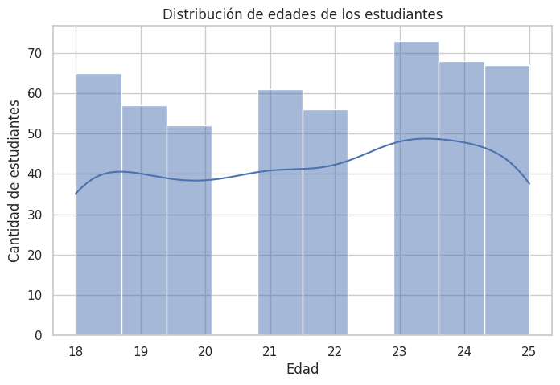

# Análisis de ingresos y egresos de estudiantes universitarios

## Descripción del proyecto

Este proyecto forma parte del trabajo final integrador de análisis de datos. Su objetivo es explorar los ingresos, la ayuda financiera y los gastos de estudiantes universitarios, utilizando Python, Power BI y GitHub.

## Dataset

Se trabajó con un conjunto de datos de 499 registros y 18 columnas originales. Luego de revisar la información, se eliminó la columna Unnamed: 0, ya que funcionaba como un índice consecutivo y no aportaba información relevante. El dataset limpio quedó compuesto por 499 filas y 17 variables.

## Limpieza y preparación

Se realizó una auditoría de calidad de datos. No se encontraron valores nulos ni filas duplicadas. También se analizaron posibles valores atípicos mediante el método del rango intercuartílico (IQR), sin detectar casos que requirieran eliminación.

## Análisis exploratorio

Se realizaron cinco visualizaciones en Python para analizar la distribución de edades e ingresos, los gastos promedio por categoría y las diferencias de ingresos según el año de cursada y el género.

Entre los resultados observados, la categoría tuition presentó el mayor gasto promedio. El grupo freshman registró el mayor ingreso promedio según el año de cursada, mientras que non binary presentó el mayor promedio según el género.

## Dashboard

Se desarrolló un dashboard interactivo en Power BI con indicadores de edad promedio, ingreso mensual promedio y ayuda financiera promedio. También se incorporaron gráficos y filtros por género, carrera y año de cursada.

## Limitaciones

El conjunto de datos contiene 499 registros, una cantidad inferior al tamaño recomendado en la consigna. Además, la fuente no especifica claramente la moneda ni el período de referencia de todos los importes, por lo que los resultados se interpretan con cautela y no se atribuye una moneda específica.

## Herramientas utilizadas

- Python
- Pandas
- Matplotlib
- Seaborn
- Power BI
- GitHub

- ## Visualizaciones del análisis

### Distribución de edades

### Distribución de ingresos mensuales

### Gasto promedio por categoría

### Ingreso promedio según año de cursada

### Ingreso promedio según género

## Dashboard de Power BI

El proyecto incluye un dashboard desarrollado en Power BI, con indicadores, gráficos y filtros por género, carrera y año de cursada.

[Ver dashboard completo en PDF](data/raw/notebooks/dashboard/dashboard_tp_finalpdf.pdf)

## Datos del proyecto

- *Autora:* [Maria Gabirondo]
- *Curso:* [Herramientas Basicas para el Analisis de Datos]
- *Cohorte:* [Sep-Nov 2026]
- *Fuente del dataset:* [Kaggle.com]
